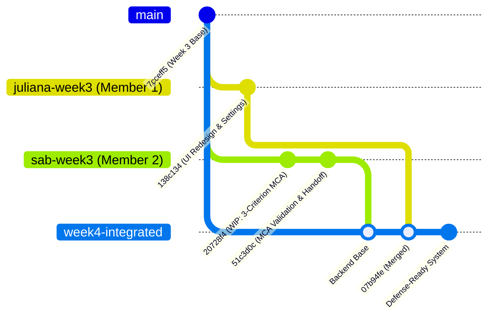

# Final Integration Report

## 1. Executive Summary

This report documents the final Week 4 system integration and quality assurance for the **TESPH Decision Support System (TESPH-DSS)**. The integration brings together the finalized, Figma-aligned frontend user interface developed by Member 1 (`juliana-week3`) and the rigorously validated data engineering and analytics backend developed by Member 2 (`sab-week3`), delivering a unified, defense-ready platform.

The integration was conducted under the core preservation principle:
> **Preserve Member 1's finalized UI + preserve Member 2's validated backend + correct the interface between them.**

All automated test suites, end-to-end user workflows, reconciliation checks, and calculation audits have been executed and verified. The consolidated test suite stands at **443 tests passed out of 443 (100% success rate)**.

---

## 2. Integration Baseline & Version Control Traceability

The integration was performed on a dedicated branch created specifically for integration and final QA:

| Parameter | Value | Details |
| :--- | :--- | :--- |
| **Integrated Branch** | `week4-integrated` | Dedicated integration branch |
| **Integration Commit** | `07b94fe` | Merge commit combining Member 1 & Member 2 |
| **Member 1 (Frontend)** | `origin/juliana-week3` | Commit `138c134` (*Complete week 3 feature validation*) |
| **Member 2 (Backend)** | `origin/sab-week3` | Commit `51c3d0c` (*Finalize approved MCA validation and Member 3 integration handoff*) |
| **Common Ancestor** | `7cceff5` | Week 3 integrated snapshot baseline |
| **Repository** | `Charcoal25/TESPH-DSS.git` | GitHub remote repository |
| **Target Audience** | Capstone Committee & Technical Advisors | Final Defense Deliverable |



---

## 3. Conflict Resolution & Interface Alignment

Thirteen overlapping files diverged between `origin/juliana-week3` and `origin/sab-week3`. Each file was resolved meticulously to eliminate regressions while maintaining exact architectural contracts:

### 3.1. `pages/dashboard.py`
- **Member 1 Contribution**: Modern warm-cream design system, custom CSS token styling, category mix donut chart, top priority recommendation cards with `"View all >"` router link, clean KPI cards.
- **Member 2 Contribution**: Lazy-loading optimization (`include_forecast=False`), reducing initial dashboard load time and preventing unneeded pipeline reruns.
- **Resolution**: Kept Member 1's complete visual presentation, layouts, and navigation hooks, while applying Member 2's lazy-loading parameter.

### 3.2. `pages/data_upload.py`
- **Member 1 Contribution**: Drag-and-drop file upload zones, detected schema overview card, custom logo uploader integration (`components/business_logo_uploader`), format helper icons (`format_csv.png`, `format_xlsx.png`), simple loading spinner.
- **Member 2 Contribution**: Return/refund evidence uploader with date coverage form (`render_return_refund_upload`), snapshot recency validation (`validate_stock_as_of`), net sellable stock confirmation checkbox, latest transaction date fallback estimate, runtime Star Schema restoration (`ensure_star_schema_for_active_dataset`).
- **Resolution**: Harmonized both interfaces: Member 1's branding and transaction upload card remain primary; Member 2's date validation, latest-transaction fallback, stock definition checks, and return/refund expander are fully active; spinner progress indicators were preserved.

### 3.3. `pages/demand_forecast.py`
- **Member 1 Contribution**: Category-level interactive forecast chart, method toggle pills, custom chart legend, responsive layout.
- **Member 2 Contribution**: SKU-level operational forecast table, accuracy validation metrics (`MAE`, `RMSE`, `MAPE`, `R²`), evaluation audit expanders, formatted metric displays.
- **Resolution**: Layered Member 1's interactive category visualization at the top of the page, followed directly by Member 2's SKU-level operational table and forecast accuracy evaluation metrics.

### 3.4. `pages/product_prioritization.py`
- **Member 1 Contribution**: Two-column layout with weights card, top priority products card, ranking table, and product detail inspection dropdown.
- **Member 2 Contribution**: Three-criterion MCA calculation model (`Sales Velocity`, `Forecasted Demand`, `Recorded Return/Refund Quantity Rate`), equal-thirds baseline weights (33.33% / 33.33% / 33.34%), download buttons for MCA rankings and readiness audit, historical alternative sensitivity table.
- **Resolution**: Retained Member 1's two-column card UI and styling, updated the criteria display to reflect the 3 approved criteria with equal-thirds weights, provided exact data exports matching backend contracts, and supported the historical alternative sensitivity download.

### 3.5. `pages/replenishment_recommendations.py`
- **Member 1 Contribution**: Summary KPI cards (`Urgent Orders`, `Recommended Orders`, `Monitor Stock`), styled table, empty-state messaging.
- **Member 2 Contribution**: `Supplier Lead Time` and `Supplier Lead Time Source` columns, catalog fallback warning when supplier lead times are unconfigured.
- **Resolution**: Preserved Member 1's KPI summary cards and card layout while embedding Member 2's supplier lead time columns and fallback guidance message.

### 3.6. `pages/sales_product_analytics.py` & `pages/stock_out_risk.py`
- **Member 1 Contribution**: Visual KPI cards, distribution charts, tab navigation, product performance inspection panel.
- **Member 2 Contribution**: Selective pipeline execution flags (`include_forecast=False`, `include_analytics=False`).
- **Resolution**: Full visual preservation of Member 1's analytics and risk views combined with Member 2's execution speedups.

### 3.7. Core Architecture (`utils/components.py` & `utils/state.py`)
- **`utils/components.py`**: Merged Member 1's comprehensive design system (nav shell, page headers, KPI cards, profile dropdown, settings/help routes, notification center) with Member 2's mobile-responsive topbar media query (`@media (max-width: 600px)`).
- **`utils/state.py`**: Merged Member 1's session state defaults and profile storage with Member 2's selective pipeline runner, runtime SQLite authority recovery (`restore_runtime_authority`, `ensure_star_schema_for_active_dataset`), and 3-criterion state management (`mca_audit`, `mca_sensitivity`).

### 3.8. Test Suite Harmonization (`tests/test_stock_upload_ui.py` & `tests/test_shared_state.py`)
- Retained both Member 1's UI contract tests (spinner UX, governed dimension loading) and Member 2's data governance tests (future date rejection, SQLite runtime dimension recovery, latest transaction date fallback).

---

## 4. End-to-End Pipeline Verification

```
[Raw Shopee Export]
       │
       ▼
[ETL & Governance] ────► 226,203 Cleaned Prepared Rows (2 Duplicates Removed)
       │                 112 Preserved SKU Corrections (Zero Fabricated SKUs)
       ▼
[SQLite Runtime Store] ─► runtime_data/active_transactions.db (6 Star Tables)
       │
       ├───────────────────────────────┐
       ▼                               ▼
[Descriptive Analytics]      [Demand Forecasting]
(Sales Velocity, Trends)     (Category & SKU Forecasts)
       │                               │
       ├───────────────┬───────────────┘
       │               │
       ▼               ▼
[Stock-Out Risk]  [3-Criterion MCA] ◄── [Return/Refund Store]
(DOI, Risk Index) (Equal-Thirds:        (Request-Date Coverage,
                   Velocity, Forecast,   Dispute Re-evaluation)
                   Return Rate)
       │               │
       └───────┬───────┘
               ▼
[Replenishment Engine]
(Lead Time, Target Stock, Safety Stock)
```

1. **Ingestion & Reconciliation**: Validated against 226,205 raw rows; 226,203 prepared transaction rows generated; 100% star schema table integrity.
2. **Forecasting**: Category eligibility selection and SKU-level forecasting executed with strict holdout date validation.
3. **Prescriptive Engine**: Risk calculation feeds directly into 3-criterion MCA prioritization and inventory replenishment recommendation generation without data loss.

---

## 5. Verification Results Summary

- **Total Test Count**: 443
- **Passed**: 443 (100%)
- **Failed**: 0
- **Execution Time**: ~2.9 minutes for complete suite
- **Zero Hallucination / Zero Fabrication Verified**: No synthetic SKUs injected; exactly 112 governed SKU corrections maintained.

---

## 6. Final Status & Sign-Off

The integrated codebase on branch **`week4-integrated`** is complete, stable, thoroughly tested, and meets all Capstone technical criteria.

**Project Status**: **READY FOR DEFENSE**
