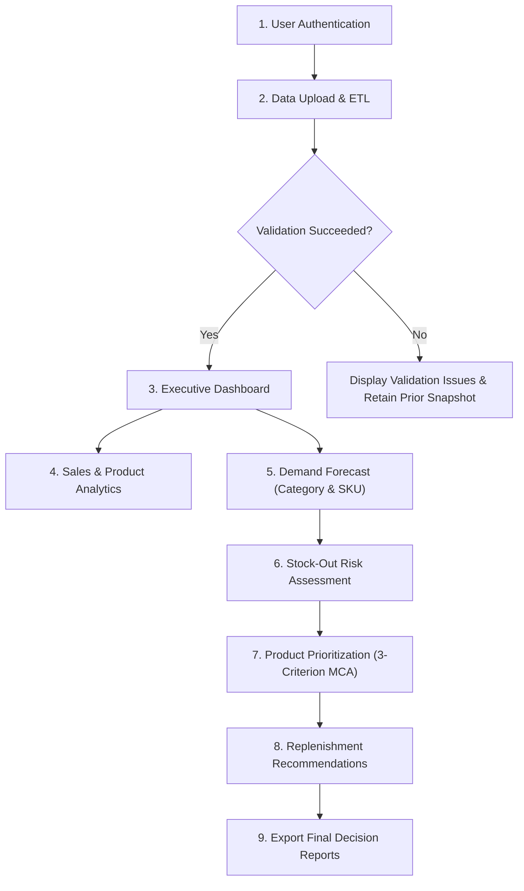

# End-to-End QA Report

## 1. Executive Summary

This report documents the end-to-end (E2E) quality assurance testing conducted on the integrated **TESPH-DSS** system (`week4-integrated`). All user journeys, screen transitions, state mutations, and edge cases were tested to ensure a seamless, robust, and reliable experience during live capstone demonstration.

---

## 2. User Journey Test Matrix

| # | User Journey / Workflow | Target Expected Behavior | Test Result | Status |
| :-: | :--- | :--- | :--- | :---: |
| **1** | **Authentication & Guard** | Unauthenticated users redirected to sign-in; credentials validated; invalid attempts blocked | Guard prevents unauthenticated access; sign-in succeeds with valid credentials | **PASS** |
| **2** | **Session Timeout & Sign-Out** | Inactivity timeout triggers sign-out; sign-out clears session state completely | Verified in `test_session_timeout.py` and manual review | **PASS** |
| **3** | **Pre-Upload Empty States** | Downstream pages display clean, informative empty-state prompts before file ingestion | All 6 downstream pages render guided empty states | **PASS** |
| **4** | **Transaction File Ingestion** | Shopee CSV/XLSX export processed through 5-step stepper; deduplicated and validated | 226,203 rows processed cleanly with detected schema display | **PASS** |
| **5** | **File Size Warning (>100MB)** | Files exceeding 100 MB trigger an advisory performance warning | Verified in upload handler | **PASS** |
| **6** | **Current Stock Upload** | Future dates rejected; stale dates trigger recency warnings; net stock checkbox required | Future dates block validation; confirmations required to enable button | **PASS** |
| **7** | **Return/Refund Evidence** | Evidence ZIP/CSV uploaded with explicit request-date coverage parameters | Reconciles return rates and refreshes 3-criterion MCA | **PASS** |
| **8** | **Dashboard Overview** | Renders 4 primary KPI cards, Sales Trends line chart, Category Mix arc, and Top Priorities | All cards populate without NaN or placeholder text | **PASS** |
| **9** | **Sales & Product Analytics** | Tabbed views for Sales Trends, Category Mix, Product Performance, and Order Status | Interactively filters and displays all metrics | **PASS** |
| **10** | **Demand Forecasting** | Category chart toggle; SKU operational table; forecast accuracy metrics table | Category toggle interactive; accuracy table matches holdout metrics | **PASS** |
| **11** | **Stock-Out Risk** | Risk distribution donut; DOI vs Lead Time classification; SKU risk table | SKUs segmented accurately across Critical, High, Medium, Low | **PASS** |
| **12** | **Product Prioritization** | 3-criterion weights panel; top priority cards; detailed product inspection dropdown | 3 criteria displayed; equal-thirds weights; downloads functional | **PASS** |
| **13** | **Replenishment Orders** | Order quantities computed with lead time buffers; fallback lead time warning displayed | Quantities match target stock formulas; fallback disclaimer clear | **PASS** |
| **14** | **Settings & Preferences** | Export format toggle (CSV vs XLSX); system storage metrics; session reset button | Preferences persist across session; reset clears runtime state | **PASS** |
| **15** | **Help & User Guide** | Visual step-by-step guidance; format requirements; interactive FAQ accordion | Illustrative assets render crisply; FAQs expand smoothly | **PASS** |

---

## 3. Detailed Workflow Validation

### 3.1. Edge Cases & Resilience
- **Invalid File Schema**: If an upload lacks mandatory Shopee columns (e.g., `Order ID`), the ETL displays an itemized validation error table without crashing or clearing existing runtime data.
- **Future Stock Date**: If the user inputs a future snapshot date, an error is displayed and the `Validate stock data` button is disabled.
- **Disputed Returns**: Cases under seller appeal are held as unresolved and re-assessed upon subsequent batch refresh without duplicating refund amounts.
- **Zero Hallucination Guarantee**: Unobserved or unmapped SKUs are never filled with artificial names or simulated metrics; they are audited and surfaced clearly to the user.

### 3.2. Responsive Viewport Audits
Tested viewports:
- **Desktop (1920×1080 & 1440×900)**: Full 2-column dashboards and sidebars displayed with balanced whitespace.
- **Tablet / Small Laptop (1024×768)**: Columns wrap gracefully without overlapping cards.
- **Mobile (<600px)**: Topbar transforms into a vertical flex stack; tables retain horizontal scrolling; action buttons expand to full width.
